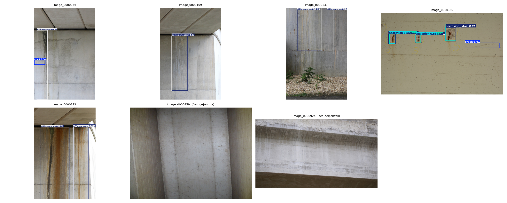
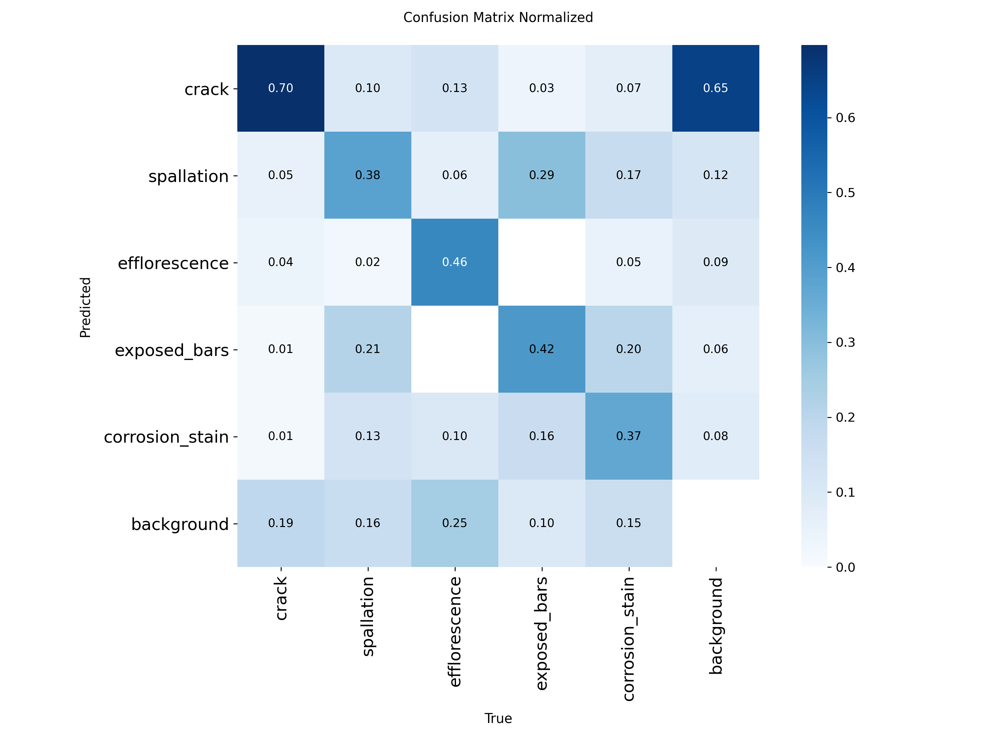

# Детекция повреждений бетона мостов: каскадные нейросети

Код выпускной квалификационной работы (бакалавриат, ПМИ, Самарский университет, 2026):
**«Исследование каскадных архитектур нейронных сетей для обнаружения и классификации повреждений бетонных мостовых конструкций»**.

Цель: автоматически находить на фотографиях мостов повреждения бетона и определять их тип. Идея работы — каскад из двух моделей: детектор с пониженным порогом находит почти все повреждения (высокая полнота), а классификатор фрагментов отсеивает ложные срабатывания (точность).



## Данные

[CODEBRIM](https://zenodo.org/records/2620293) (Mundt et al., CVPR 2019): 1590 фото 30 мостов, 5181 рамка, 5 классов — трещина, скол, высолы, оголённая арматура, ржавые подтёки.

Особенности, которые определили решения:

| Особенность | Что сделано |
|---|---|
| **Многометочность** — 38 % рамок имеют 2+ класса (арматура почти всегда вместе с ржавчиной) | Рамка дублируется для каждого класса; анализ совместной встречаемости |
| **Дисбаланс** — трещин в 3 раза больше, чем высолов | Метрики по каждому классу, стратификация по самому редкому классу на фото |
| **36 % фото без повреждений** | Остаются в выборках с пустой разметкой — по ним считаются ложные срабатывания |
| **Огромные фото** (до 6000×4000) и перепутанная EXIF-ориентация | Уменьшение до 1600 px с пересчётом рамок и проверкой ориентации по размеру из XML |
| **Утечка данных** | Разбиение 70/15/15 по фотографиям, а не по рамкам; test используется только для итоговой оценки |

Данные в репозиторий не входят (лицензия допускает только некоммерческое использование): ноутбук сам скачивает архив и проверяет MD5.

## Этап 1. Базовая модель YOLOv8n

Дообучение YOLOv8n, предобученного на COCO: 100 эпох, ранняя остановка, AdamW, 640 px, GPU T4. Три независимых запуска (seed 0, 1, 2).

**Test (239 фото):**

| Метрика | Среднее ± std |
|---|---|
| mAP@0.5 | 0.326 ± 0.011 |
| mAP@0.5:0.95 | 0.155 ± 0.006 |
| Precision | 0.413 ± 0.036 |
| Recall | 0.389 ± 0.016 |
| F1 | 0.400 ± 0.011 |
| Время инференса | 4–6 мс / фото (T4) |

**AP@0.5 по классам:** оголённая арматура 0.490 · скол 0.384 · ржавые подтёки 0.366 · высолы 0.216 · трещина 0.175.

**Анализ ошибок:**
- Результат воспроизводим: коэффициент вариации mAP@0.5 по запускам — 3.5 %.
- 65 % ложных срабатываний — «трещины»: модель путает их со швами опалубки, стыками плит и тенями. Именно их должен отсеивать второй каскад.
- Классы «скол — арматура — ржавчина» путаются между собой: физически это одна цепочка разрушения, и они находятся в одних местах.
- Оптимальный порог уверенности различается по классам (≈0.22 для трещин, ≈0.33 для арматуры), поэтому пороги каскада подбираются по классам.



**Ограничение:** номер моста в разметке не указан, поэтому фото одного моста могут попасть в разные выборки. Это может немного завышать абсолютные метрики, но одинаково влияет на все сравниваемые модели.

## Структура

```
notebooks/
  01_data_and_yolov8_baseline.ipynb   # данные, статистика, разбиение, YOLOv8, оценка
figures/                              # графики из ноутбука
results/                              # summary.csv, метрики по классам
requirements.txt
```

## Запуск

Google Colab с GPU T4: открыть ноутбук и выполнить ячейки по порядку. Первый запуск (скачивание и подготовка данных) — около часа, данные кэшируются на Google Диске.

Локально: `pip install -r requirements.txt`, нужен GPU.

## Планы

- [x] Этап 1: подготовка данных и базовая модель YOLOv8n
- [ ] YOLOv8s, сравнение размера входа 640 / 1024
- [ ] Этап 2: классификатор фрагментов (второй каскад)
- [ ] Подбор порогов каскада, сравнение с одиночным детектором

## Стек

Python · PyTorch · Ultralytics YOLOv8 · pandas · NumPy · scikit-learn · Matplotlib · Pillow · Google Colab
